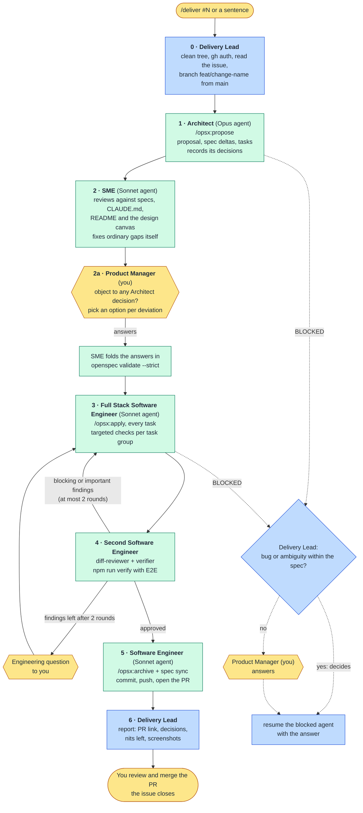

# Agentic SDLC: adding a feature to My Fitness

How a new feature goes from idea to merged code with Claude Code, OpenSpec, the project sub-agents and the repo scripts. Setup details are in [DEVELOPMENT.md](DEVELOPMENT.md); the rules Claude follows are in [CLAUDE.md](CLAUDE.md).

```
 explore ──> propose ──> apply (per task group) ──> archive ──> ship
   │            │          │  implement                 │          │
   │            │          ├─ verifier (Haiku)          │          │
   │            │          ├─ diff-reviewer (Sonnet),   │          │
   │            │          │  server/, shared/ groups   │          │
   │            │          └─ final group: review all,  │          │
   │            │             full suite incl. E2E      │          │
 /clear      /clear      /clear                      /clear     commit/PR
```

OpenSpec keeps the state of a change in files under `openspec/`, so you can `/clear` the conversation between phases without losing anything. Each phase then starts with a small context, which saves tokens.

## 1. Explore (optional): `/opsx:explore <idea>`

Think the idea through with Claude and settle the scope. Nothing is written unless you ask for it.

- `openspec/config.yaml` gives every OpenSpec step the project's constraints: phone-first use, private data, English names, the security setup and the required test layers. You don't need to repeat them.
- When the idea is clear, run `/clear`.

## 2. Propose: `/opsx:propose <what you want>`

Creates the change in `openspec/changes/<name>/`:

| File | Contents |
|---|---|
| `proposal.md` | Why and what, under one page, with what is out of scope |
| `specs/<capability>/spec.md` | Requirements and scenarios, with made-up English examples |
| `design.md` | Only for data model, dependency, cross-cutting or security changes |
| `tasks.md` | Task groups, each with its own tests and docs, ending with a full integration check |

Review the files, ask for changes if needed, then run `/clear`.

## 3. Apply: `/opsx:apply`

For each task group, Claude:

1. implements the group;
2. runs the **`diff-reviewer`** sub-agent (Sonnet) on the group's changes, but only when the group touches `server/`, `shared/` or `nuxt.config.ts`, and fixes blocking or important findings;
3. runs the **`verifier`** sub-agent (Haiku) on the group's targeted checks: the test files its tasks name, or `npm run verify` without E2E when none fit. It reports only failures;
4. ticks the group's tasks in `tasks.md`.

The last task group is the integration check: `diff-reviewer` reviews the whole change once (`git diff main...HEAD` plus uncommitted changes), and `verifier` runs the full suite with `npm run verify -- --e2e`.

Steps 2 and 3 come from the apply guidance in `openspec/config.yaml`, so they happen without asking. Progress lives in `tasks.md`, so on a long change you can `/clear` between task groups and run `/opsx:apply` again.

## 4. Archive: `/opsx:archive`

Merges the change's specs into `openspec/specs/`, validates them (`openspec validate --specs --strict`), runs `npm run hygiene` and moves the change to `openspec/changes/archive/`.

## 5. Ship

Ask in one line, for example *"commit on a branch, push and open a PR"* or *"commit and push to main"*.

- The pre-commit hook runs the hygiene check on every commit.
- CI runs hygiene, lint, typecheck, unit and API tests, and the Docker E2E suite.

## Automated: `/deliver <requirement>`

Runs steps 2 to 5 end to end with a team of agents and stops at an open PR. Give it one requirement: a roadmap issue (`/deliver #9`) or a sentence (`/deliver show the rest timer in gym mode`). The steps are in `.claude/commands/deliver.md`.



Yellow: you, the Product Manager. Blue: the main session, the Delivery Lead. Green: sub-agents. Dashed arrows: an agent stops with `BLOCKED` instead of guessing. Every stage's state lives in `openspec/changes/<change>/`, so each agent starts cold from the files, not from the conversation.

| Stage | Role | Who | Does |
|---|---|---|---|
| 0 | Delivery Lead | the main session | Reads the requirement (and its issue), checks the working tree is clean, branches `feat/<change>` from `origin/main` |
| 1 | Architect | Opus agent | `/opsx:propose`: proposal, spec deltas, tasks; decides open questions and records them in the proposal |
| 2 | SME | Sonnet agent | Reviews the proposal against the specs, `CLAUDE.md`, the README roadmap and the design; fixes ordinary gaps, reports true deviations |
| 2a | Delivery Lead, with you as Product Manager | the main session | Lists the Architect's product decisions for you to object to, asks you about true deviations, then hands your answers back to the SME |
| 3 | Full Stack Software Engineer | Sonnet agent | `/opsx:apply`: implements every task and runs the checks |
| 4 | Second Software Engineer | `diff-reviewer` and `verifier` | Reviews the whole change; findings go back to stage 3 (at most two rounds), then `npm run verify -- --e2e` |
| 5 | Software Engineer | Sonnet agent | `/opsx:archive` with spec sync, refreshes README screenshots if a shown screen changed, commits, pushes, opens the PR with `Closes #N` |
| 6 | Delivery Lead | the main session | Reports the PR link, the decisions you let stand and the ones you made |

You are the Product Manager and make the product decisions. Before any code is written you see the Architect's product decisions in one list (object to any, the rest stand) and are asked about each true deviation the SME finds: a change that contradicts an existing spec, breaks a repo rule, differs from the design where the README does not list the difference as deliberate, or goes beyond the requirement. Engineering questions (review findings left after two rounds, git conflicts, force pushes) are labelled as such. Nothing is merged; you review and merge the PR.

- Start from a clean working tree; the Delivery Lead stops otherwise.
- Sub-agents cannot start sub-agents, so the main session runs `verifier` and `diff-reviewer`.
- Run it in a session on Opus (the Delivery Lead judges the review findings); the other roles set their own models.

## Running checks yourself

| Goal | Command |
|---|---|
| Everything except E2E, one line per step | `npm run verify` |
| Everything including E2E | `npm run verify -- --e2e` |
| One E2E test against a throwaway server | `npm run test:e2e:local -- --no-build e2e/<file>.spec.ts -g "<test name>"` |
| Only the repository rules | `npm run hygiene` |

`test:e2e:local` starts the production build on a free port with a temporary database and test credentials. It never uses your `.env` or `./data`.

## Repository rules (enforced by `npm run hygiene`)

- **English in code and tests:** identifiers, file names and exercise names in tests and fixtures. The only Polish allowed is the trainer's PDF header labels, which the importer has to recognise.
- **No real data:** no real plans, names or video links. Use made-up values and `https://example.com/...` links. The test plan PDF is generated by `scripts/make-plan-fixture-pdf.mjs`.
- **Private terms:** put names you never want committed, one per line, in `.hygiene-blocklist` in the repo root. The file is gitignored, so the terms stay private.

## Tips

- **Small fixes** (a typo, a one-file bug) don't need OpenSpec. Describe the fix, then ask for the `verifier` if you want a check.
- **Review on demand:** *"use diff-reviewer on my uncommitted changes"*.
- **New machine or clone:** run `npm run hooks:install` once, `npx playwright install chromium` for local E2E, and create your `.hygiene-blocklist`.
- **Sub-agents** are read from `.claude/agents/` when a session starts; after changing them, run `/agents` or start a new session.
